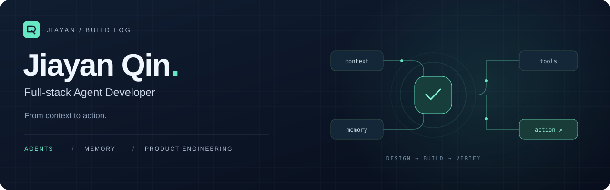
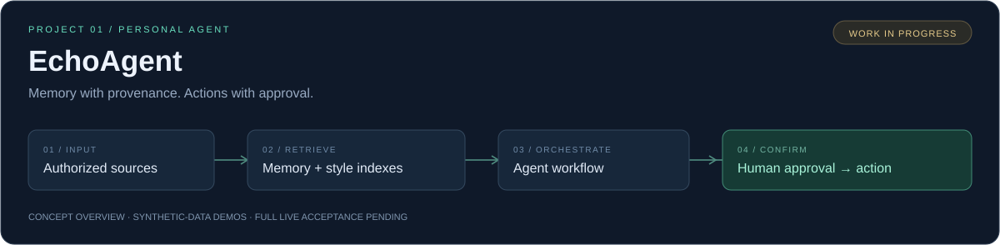

  

<a href="README.md">中文</a> · <a href="projects/echoagent.md">Featured project</a> · <a href="mailto:qjyvictory@163.com">Get in touch ↗</a>

# Hi, I'm Jiayan Qin.

**A full-stack developer building agents for real workflows.**

I work across memory and retrieval, agent orchestration, tool execution, and the interfaces that make these systems usable. Currently a **Full-stack Agent Development Intern at Tezign**.

- **Building**: EchoAgent, a personal agent workspace exploring persona memory, expression style, and controlled tool execution.
- **Experience**: multi-stage research agents, enterprise RAG, multimodal order editing, SSO / IAM, and private deployment.
- **Education**: Undergraduate studies in Computer Science and Technology, Beijing Jiaotong University (2022–2026). Admitted to a master's program in computer science at the Australian National University; entry July 2027.
- **Open to**: Agent / RAG / full-stack collaboration and internship opportunities through July 2027.

> Build agents that can explain their sources, pause for approval, and finish the workflow.

## 01 / Selected work

### EchoAgent · Personal memory, controlled actions

A development prototype for source-grounded persona conversations and approval-based tools. Its engineering focus is separating factual memory from expression style, preserving provenance, and making imported data retractable.

`Python` `FastAPI` `LangGraph` `React` `TypeScript` `PostgreSQL` `pgvector` `Docker`

The workspace brings together chat, personas, memory, imports, feedback, and costs. Synthetic-data demos and engineering checks are available; full live acceptance and a stable release are pending. Voice and avatar integration remain future directions.

**[Project overview ↗](projects/echoagent.md)** · [Private source repository — access required](https://github.com/QinJiayan-maker/virtual-human)

### Visual tracking · Connecting perception to motion

A local project combining YOLO detection, NanoTrack tracking, Kalman filtering, and serial communication with an STM32 pan-tilt controller. Includes desktop and web interaction modes.

`Python` `OpenCV` `YOLO` `NanoTrack` `STM32`

**[Project overview ↗](projects/visual-tracking.md)** · Source has not been published here.

## 02 / Applied engineering

**Tezign · Full-stack Agent Development Intern** · May 2026–present  
Contributed to a seven-stage research-agent workflow, team knowledge retrieval, source-aware reporting, enterprise authentication, multimodal asset search, and private deployment.

**Intelligent Order Agent · Project experience** · February–April 2026  
Built a Next.js H5 workflow for voice, text, and photo-assisted order editing, with SKU validation, bounded tool calls, order drafts, native checkout integration, and IAM integration.

**Beijing Computing Center · Java Engineering Intern** · July–September 2024  
Worked on Spring Boot / MyBatis Plus backend APIs for collectible filtering and user account features.

Enterprise work is described at the responsibility and architecture level; this profile does not distribute enterprise source code.

## 03 / Toolkit

- **Agents & retrieval**: tool calling, state-machine orchestration, prompts, RAG, pgvector, Milvus.
- **Full-stack**: TypeScript, React, Next.js, Python / FastAPI, Java / Spring Boot.
- **Data & integration**: PostgreSQL, MySQL, Redis, SSO / IAM, Docker, object storage.

## 04 / Let's build something useful

Interested in practical agent products, reliable retrieval and memory, and end-to-end software delivery.

**[qjyvictory@163.com](mailto:qjyvictory@163.com)** · [GitHub](https://github.com/QinJiayan-maker)

---

From context to action. Built with evidence, shipped with care.
